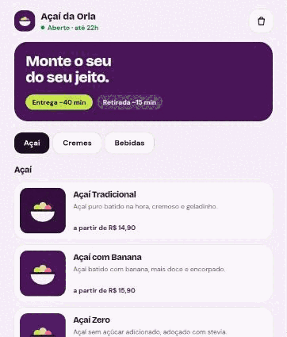
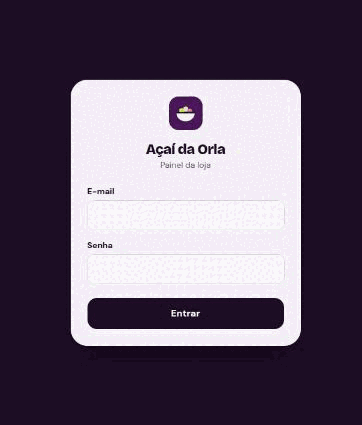
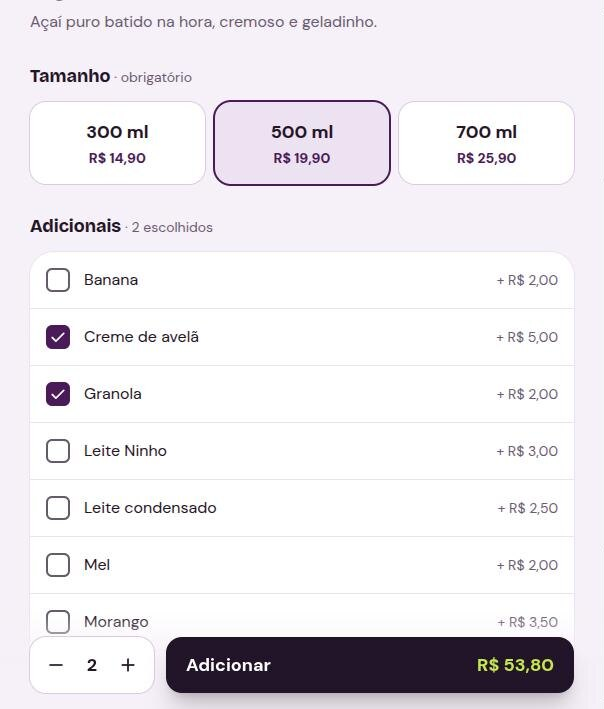
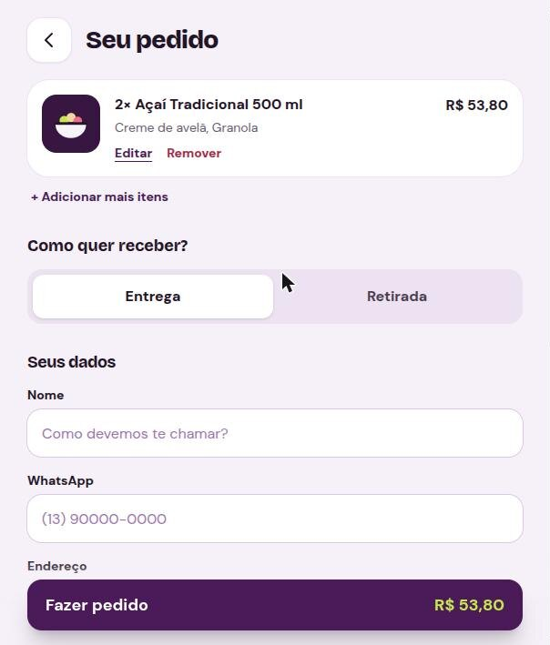
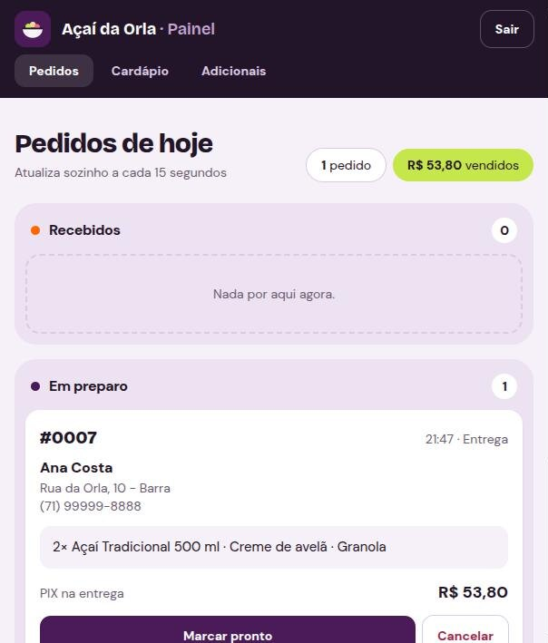
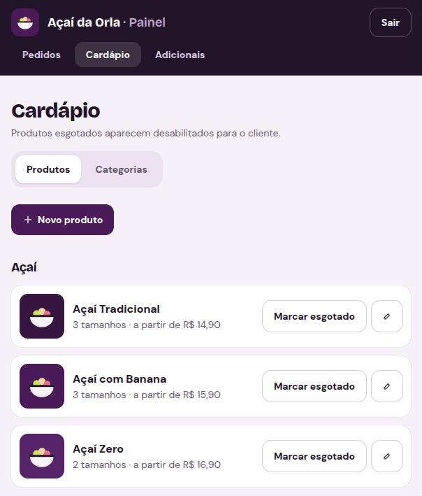

# Cardápio Digital — Açaí da Orla

> **Site:** [cardapio-acai.vercel.app](https://cardapio-acai.vercel.app) · **API (Swagger):** [acai-da-orla-api.onrender.com/docs](https://acai-da-orla-api.onrender.com/docs)

O cliente monta o açaí pelo celular e faz o pedido, e o dono acompanha tudo num painel. O pagamento é na entrega, e o resumo do pedido vai para a loja pelo WhatsApp.

"Açaí da Orla" é uma **marca fictícia**, criada só para este projeto de portfólio.

<table>
  <tr>
    <th>Cliente: do cardápio ao WhatsApp</th>
    <th>Painel: pedido chegando e mudando de status</th>
  </tr>
  <tr>
    <td></td>
    <td></td>
  </tr>
</table>

**Login de demonstração do painel:** `admin@acaidaorla.com` / `admin123` em [cardapio-acai.vercel.app/admin](https://cardapio-acai.vercel.app/admin)

> A API usa o plano gratuito do Render: depois de um tempo parada, o primeiro acesso leva ~50 s para acordar.

---

## Funcionalidades

**Cliente**
- Cardápio por categoria (açaí, cremes, bebidas) com "a partir de R$ X".
- Montagem do produto: tamanho, adicionais, quantidade e observação, com preço atualizando na hora.
- Carrinho salvo no navegador.
- Tela "Seu pedido" com carrinho e checkout juntos: editar ou remover itens, entrega ou retirada e pagamento na entrega (dinheiro, cartão ou PIX na hora).
- Confirmação com número do pedido e botão **Enviar no WhatsApp** com o resumo pronto.

**Painel do dono**
- Login com JWT.
- Pedidos por status, atualizando sozinhos a cada 15 segundos.
- Botões para avançar ou cancelar o pedido, seguindo as regras de status.
- Cadastro de produtos, tamanhos, adicionais e categorias.
- Botão de esgotado: o produto aparece desabilitado no cardápio na hora e não pode ser pedido.

## Telas

| Cardápio | Montagem | Seu pedido |
|---|---|---|
|  |  |  |

| Confirmação | Painel de pedidos | Cardápio no painel |
|---|---|---|
|  |  |  |

## Regras de negócio que importam

- **O servidor recalcula o total.** O front só manda ids e quantidades; os preços vêm do banco. Se o front tentar mandar um `total`, a API recusa.
- **Preços com `Decimal`**, nunca `Float`, para não perder centavos.
- **O pedido copia os preços.** `ItemPedido` e `ItemAdicional` guardam o preço do dia da compra, então mudar o cardápio não altera pedidos antigos.
- **O pedido é validado inteiro**: o tamanho tem que ser do produto, o produto e os adicionais têm que estar ativos, e só categorias que aceitam adicionais recebem adicionais. Tudo é gravado numa transação (`prisma.$transaction`).
- **Máquina de estados do pedido:**
  ```
  Entrega:   RECEBIDO → EM_PREPARO → PRONTO → SAIU_PARA_ENTREGA → ENTREGUE
  Retirada:  RECEBIDO → EM_PREPARO → PRONTO → ENTREGUE
  CANCELADO: só a partir de RECEBIDO, EM_PREPARO ou PRONTO
  ```
  Quando dois admins mudam o mesmo pedido ao mesmo tempo, o segundo recebe 409 em vez de sobrescrever.
- **Histórico protegido**: um produto, tamanho ou adicional que já foi vendido não pode ser apagado, só desativado.

## Stack

| Camada | Tecnologia |
|---|---|
| Backend | NestJS 12, Prisma 7, class-validator, Passport JWT, bcrypt |
| Banco | PostgreSQL (Docker Compose local, Neon em produção) |
| Documentação da API | Swagger (`/docs`) |
| Testes | Vitest (unitários) |
| Frontend | React 19 + Vite, React Router, TanStack Query, Tailwind CSS 4 |
| Carrinho e sessão | Zustand, salvo em `localStorage` |
| Deploy | Render (API), Neon (banco), Vercel (site) |

## Estrutura

```
.
├── api/                  # NestJS
│   ├── prisma/           # schema.prisma, migrations, seed.ts
│   └── src/
│       ├── auth/         # login e guard JWT
│       ├── cardapio/     # rotas públicas do cardápio
│       ├── admin/        # CRUD protegido (categorias, produtos, tamanhos, adicionais)
│       ├── pedidos/      # criação, painel e regras (cálculo, status, montagem)
│       └── common/       # filtro de erros do Prisma
├── web/                  # React + Vite
│   └── src/
│       ├── pages/        # Cardápio, Montagem, Carrinho (com checkout), Confirmação, admin/
│       ├── components/
│       ├── carrinho/     # store do carrinho
│       ├── admin/        # sessão e componentes do painel
│       ├── api/          # cliente axios + hooks do TanStack Query
│       └── lib/          # preço, pedido, WhatsApp
├── docs/                 # GIFs e prints usados neste README
├── docker-compose.yml    # Postgres local
├── render.yaml           # blueprint da API no Render
└── DEPLOY.md             # passo a passo do deploy
```

## Como rodar localmente

Requisitos: Node 22.12+ e Docker (ou Podman).

```bash
# 1. Banco
docker compose up -d          # ou: podman compose up -d

# 2. API (http://localhost:3000, Swagger em /docs)
cd api
cp .env.example .env
npm install
npm run prisma:migrate        # cria as tabelas
npm run prisma:seed           # cardápio de exemplo + admin
npm run start:dev

# 3. Site (http://localhost:5173), em outro terminal
cd web
cp .env.example .env
npm install
npm run dev
```

## Testes e qualidade

```bash
cd api
npm test        # 47 testes unitários
npm run lint

cd ../web
npm run lint
npm run build
```

Os testes cobrem o **cálculo do total** (incluindo a prova de que o Decimal não perde centavos), **todas as transições de status** para entrega e retirada, a **validação dos itens do pedido**, o login, o guard JWT e as regras de exclusão do cardápio.

## Rotas da API

| Método | Rota | Acesso |
|---|---|---|
| GET | `/cardapio` | público |
| GET | `/produtos/:id` | público |
| POST | `/pedidos` | público |
| POST | `/auth/login` | público |
| GET | `/admin/pedidos?status=` | admin |
| PATCH | `/admin/pedidos/:id/status` | admin |
| CRUD | `/admin/categorias`, `/admin/produtos`, `/admin/produtos/:id/tamanhos`, `/admin/tamanhos/:id`, `/admin/adicionais` | admin |

Detalhes e testes interativos: Swagger em `/docs`.

## Deploy

Passo a passo em [DEPLOY.md](DEPLOY.md): Neon → Render → Vercel.

## Próximos passos

1. Tempo real com Socket.IO no lugar do polling, com alerta sonoro de pedido novo.
2. PIX online (Mercado Pago sandbox) com webhook.
3. CI com GitHub Actions rodando lint e testes.
4. Testes e2e do fluxo de pedido com supertest.
5. Horário de funcionamento e cupom de desconto.
6. Upload de foto do produto pelo painel.
